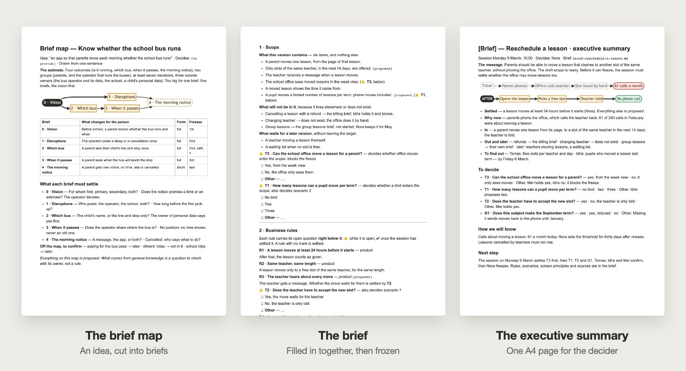

<a href="https://github.com/sebmake/FrameFirstPLS/releases/latest">

</a>

# FrameFirstPLS

Claude skills for the moment before anyone writes a spec or draws a screen. Frame first, please.

A team agrees on a subject long before it builds it, but that moment rarely gets a page. It happens in a meeting and a chat thread. Its only trace is one person's draft. The disagreements show up three documents later, when they cost a sprint.

A framing brief gives that moment one page. It freezes two things: why the subject exists, and what is in and out. Nothing gets built or specified in it. The team fills it in together, reads it aloud and signs it.

The first skill writes that page with you. Other skills for the work before the build will join it here.

| Skill | What it does |
|---|---|
| **[Framing brief](#framing-brief)** | Sizes a subject, writes the brief, its one-page summary or a brief map, and tells you whether it can freeze |

## Install

```bash
npx skills@latest add sebmake/FrameFirstPLS
```

As a Claude Code plugin:

```bash
claude plugin marketplace add sebmake/FrameFirstPLS
claude plugin install sebmake-framing-brief@framefirstpls
```

On Claude.ai, upload the `.skill` file from the [latest release](https://github.com/sebmake/FrameFirstPLS/releases/latest).

## Why use it?

Ask an agent for a scoping doc and you get a confident one. That's the problem.

Left to itself, it fills the gaps. In side-by-side tests, Claude without the skill settled the team's open questions in its summary for the decider. From a one-sentence app idea, it wrote one big document, stated regulations as facts and made up figures.

The skill does the opposite. Every line its owner hasn't confirmed is marked `[proposed]`. Every choice the team has to make becomes a question with tick boxes, and always an **Other**. A missing fact becomes a question for the person who has it, with a date. Nobody decides in someone else's place, Claude least of all.

## Framing brief

**[sebmake-framing-brief](./sebmake-framing-brief/SKILL.md)** turns notes, a draft, a meeting transcript or mockups into a framing brief, in English or French.

It sizes the subject before it writes a line. It counts what you gave it: outcomes, groups whose habits change, rules, decisions to make, outside owners like legal or another team. Too small, and it suggests a ticket instead. Too big, and it proposes the cut. Then it asks up to five numbered questions only you can answer, and writes.

It hands you one of three pages, or several:

- **The brief.** A short form for one outcome and about a week of work, signed in a one-hour session. A full form for new ground, frozen in two hours by four sentences: engineering, product, design, then the decider.
- **The executive summary.** One A4 page for the decider, or for anyone who missed the session: the message, a before/after diagram, five lines and the decisions still open.
- **The brief map.** From a one-sentence idea: how many briefs, the order they freeze in, and what each one must settle.

It can also work live, block by block, while the room fills the brief on screen. And when you ask whether a brief can freeze, it answers yes or no first, then sorts what's in the way: what sends the subject back, and what you can fix now.

A checker comes with it. It catches a missing section, a question without an **Other**, a box nobody could tick, a page that runs over, and with `--freeze`, any mark still waiting for its owner.

Needs Python 3.9 or later for the checker; no dependency.

## Limits

- Templates exist in English and French. For another language, the skill translates the English template and keeps the identifiers.
- The one-page length is measured in Arial 11 pt with 2 cm margins: about 380 words for the summary, 330 for the map. Other fonts can run over.
- The four voices at the freeze are a default. Map your own team to them.
- The tests were written alongside the skill. They show it follows its own rules, not that teams ship better with it.

---

MIT License.
