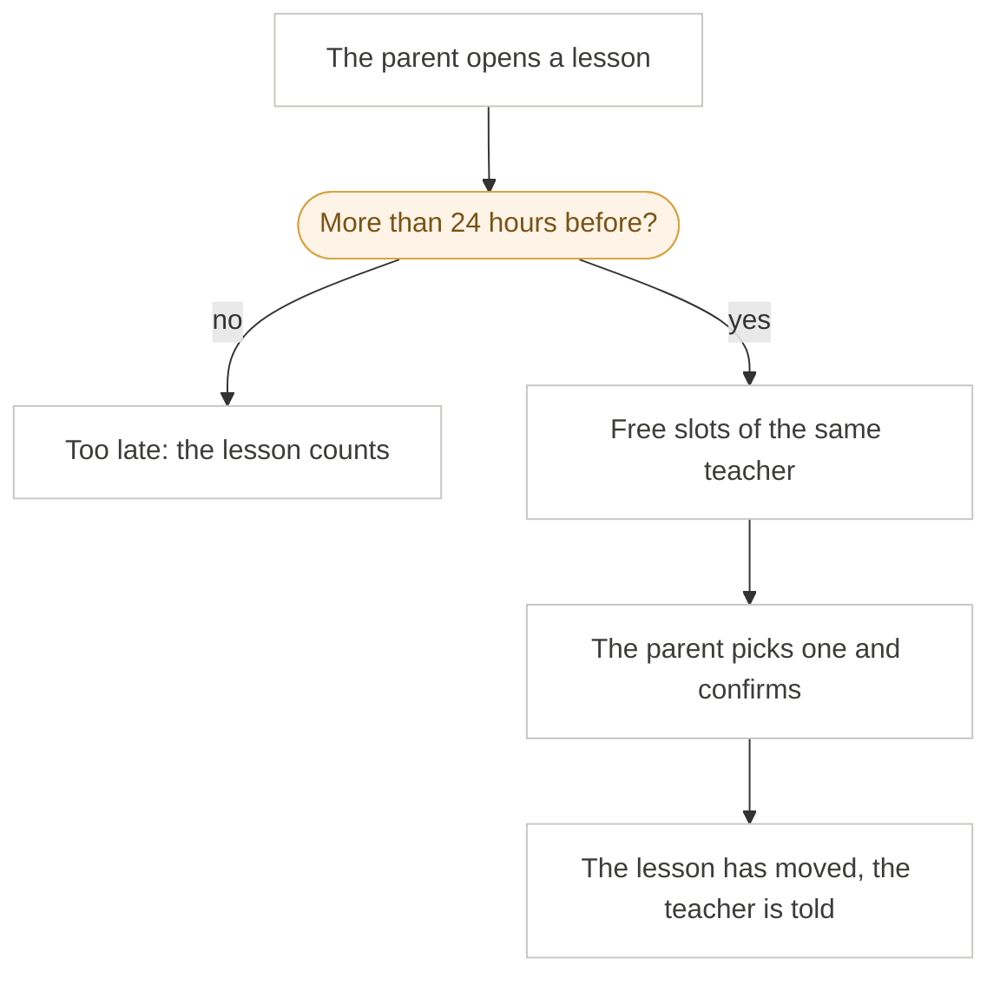

# [Brief] — Reschedule a lesson

* **Session** — Monday 9 March, 10:00 to 12:00
* **Version** — draft 1, pre-filled on 6 March. Lines marked `[proposed]` are not confirmed.
* **Spec or source** — "Rescheduling, first elements" (Idris, 4 March)
* **Design file** — Solfa · Parents app, page "Lessons"
* **Present** — Nora (decider) · Idris (product) · Mei (design) · Tomas (engineering) · June (facilitator)

> **This brief freezes the why and the scope.** Nothing is built or specified here.
>
> One answer ticked per question. If none fits, tick **Other** and write after it.
>
> **To decide:** T3 can the office move a lesson? (under the scope, blocks the freeze) · T1 how many moves per term? (under the scope) · T2 does the teacher accept? (under R3) · G1 September? (deadline)

---

## Context

* **As** — the parent of a pupil, the week a lesson clashes with something else
* **I want** — to keep the lesson, at another time that week or the next
* **So that** — the lesson is not lost, and nobody has to phone anybody
* **Today** — parents phone the office, which calls the teacher back and finds a slot by hand
* **Proof** — Nora hears it at the desk every week (*heard*) · 61 of 240 calls in February were about moving a lesson
* **We will know it worked** — calls about moving a lesson: today 61 a month · thirty days after release `[to provide]` · without more lessons cancelled by teachers `[proposed]`

---

## 1 · Scope

**What this version contains** — six items, and nothing else.

* A parent moves one lesson, from the page of that lesson.
* Only slots of the same teacher, in the next 14 days, are offered. `[proposed]`
* The teacher receives a message when a lesson moves.
* The school office sees moved lessons in the week view. (⚠️ **T3**, below)
* A moved lesson shows the time it came from.
* A pupil moves a limited number of lessons per term, phone moves included. `[proposed]` (⚠️ **T1**, below)

**What will not be in it**, because it lives elsewhere or does not exist.

* Cancelling a lesson with a refund → the billing brief; Idris holds it and knows.
* Changing teacher → does not exist; the office does it by hand.
* Group lessons → the group lessons brief, not started; Nora keeps it for May.

**What waits for a later version**, without leaving the target.

* A teacher moving a lesson themself.
* A waiting list when no slot is free.

⚠️ **T3 · Can the school office move a lesson for a parent?** — *decides whether office moves enter the scope: blocks the freeze*

- [ ] Yes, from the week view
- [ ] No, the office only sees them
- [ ] **Other** — …

⚠️ **T1 · How many lessons can a pupil move per term?** — *decides whether a limit enters the scope; also decides scenario 3*

- [ ] No limit
- [ ] Two
- [ ] Three
- [ ] **Other** — …

---

## 2 · Business rules

Each rule carries its open question **right below it**: ⚠️ while it is open, ✔ once the session has settled it. A rule with no mark is settled.

**R1 · A lesson moves at least 24 hours before it starts** — *product*

After that, the lesson counts as given.

**R2 · Same teacher, same length** — *product*

A lesson moves only to a free slot of the same teacher, for the same length.

**R3 · The teacher hears about every move** — *product* `[proposed]`

The teacher gets a message. Whether the move waits for them is settled by **T2**.

⚠️ **T2 · Does the teacher have to accept the new slot?** — *also decides scenario 1*

- [ ] Yes, the move waits for the teacher
- [ ] No, the teacher is only told
- [ ] **Other** — …

**R4 · A moved lesson keeps its price** — *calculation*

Nothing is billed or refunded when a lesson moves.

---

## 3 · Acceptance scenarios

Three or four at most: the ones that say when it is right. The rest belongs to the spec.

**Scenario 1 — The lesson moves** `[proposed]`

* **Given** a lesson in three days and a free slot of the same teacher
* **When** the parent picks the slot and confirms
* **Then** the lesson shows at the new time and the teacher gets a message

**Scenario 2 — Too late**

* **Given** a lesson that starts in ten hours
* **When** the parent opens it
* **Then** "Move" is not offered, and the page says why

**Scenario 3 — The limit is reached** `[proposed]`

* **Given** a pupil who has reached the limit for the term
* **When** the parent tries to move a lesson
* **Then** the page says to call the office

---

## 4 · The principles of each screen — to tick

**F1 — Parent - Lesson - Detail**

- [ ] "Move" is on the page of the lesson, not in a menu
- [ ] The page says until when the lesson can still move
- [ ] A moved lesson shows its original time
- [ ] **Other** — …

**F2 — Parent - Lesson - Pick a slot**

- [ ] Slots are shown day by day, never as a full calendar
- [ ] No slot of another teacher appears
- [ ] Nothing moves without a confirmation
- [ ] **Other** — …

---

## 5 · Open questions

Each one is asked **in its own thread**, to a named person. The answer is given in the thread.

* **O1** · Tomas — free slots of one teacher, per day — answer by Friday 6 March
* **O2** · Idris — how many pupils moved a lesson last term — answer by Friday 6 March

---

## 6 · Deadline

**G1 · Does this subject make the September term?** — *missing it costs: moves go back to the phone until January* `[proposed]`

- [ ] **Yes** — all of it
- [ ] **Yes, reduced** — the lines that leave move to "waits" before the freeze
- [ ] **No** — after September
- [ ] **Other** — …

---

## The freeze

- [ ] **Engineering** · Tomas — "no major obstacle in here"
- [ ] **Product** · Idris — "I can write the spec"
- [ ] **Design** · Mei — "I can start the design"
- [ ] **Decider** · Nora, last — "the problem and the scope are the ones I want"

Each one ticks their own line, or writes it in a comment: `Freeze signed · role · id`. June runs the session and does not confirm. We freeze with holes, never with a disagreement on the why or the scope.

---

## Notes and sources — *optional*

| Source | What it says |
| -- | -- |
| Nora, message of 2 March | "After 24 hours it is too late, the lesson counts." Source of R1. |
| Idris, note of 4 March | Proposes 14 days of slots and two moves per term: "beyond two, a teacher's week never settles." A move made by phone counts too. |
| Mei, sketch of 5 March | Would let the teacher accept or refuse: "a teacher who is told and never asked stops answering." |
| Idris and Mei, on T3 | Mei's sketch gives the office a "Move" button. Idris: the office only sees moves, "fewer calls, not more desk work." |
| Support export, February | 61 calls out of 240 were about moving a lesson. |
| The draft | Proposed what we count and the line on cancelled lessons. Nora sets the threshold. |

**Binding terms** — *move*: a lesson changes time. *Cancel*: a lesson is removed.

**Terms heard** — "swap", "make-up lesson".
