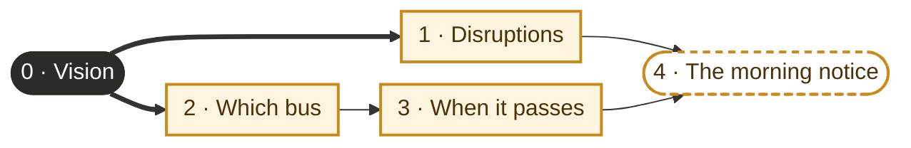

# Brief map — Know whether the school bus runs

Idea: "an app so that parents know each morning whether the school bus runs" · Decides: `[to provide]` · Drawn from one sentence

**The estimate.** Four outcomes (is it running, which bus, when it passes, the morning notice), two groups (parents, and the operator that runs the buses), at least seven decisions, three outside owners (the bus operator and its data, the school, a child's personal data). Too big for one brief: five briefs, the vision first.

| Brief | What changes for the person | Form | Freezes |
| -- | -- | -- | -- |
| **0 · Vision** | Before school, a parent knows whether the bus runs and when | full | 1st |
| **1 · Disruptions** | The operator posts a delay or a cancellation once | full | 2nd |
| **2 · Which bus** | A parent sets their child's line and stop once | full | 2nd, with 1 |
| **3 · When it passes** | A parent sees when the bus will reach the stop | full | 3rd |
| **4 · The morning notice** | A parent gets one notice: on time, late or cancelled | short | last |

## What each brief must settle

- **0 · Vision** — For whom first: primary, secondary, both? · Does the notice promise a time or an estimate? The operator decides.
- **1 · Disruptions** — Who posts: the operator, the school, both? · How long before the first pick-up?
- **2 · Which bus** — The child's name, or the line and stop only? The owner of personal data says yes first.
- **3 · When it passes** — Does the operator share where the bus is? · No position: no time shown, never an old one.
- **4 · The morning notice** — A message, the app, or both? · Cancelled: who says what to do?

**Off the map, to confirm** — paying for the bus pass → later · drivers' rotas → not in it · school trips → later.

*Everything on this map is proposed. What comes from general knowledge is a question to check with its owner, not a rule.*
