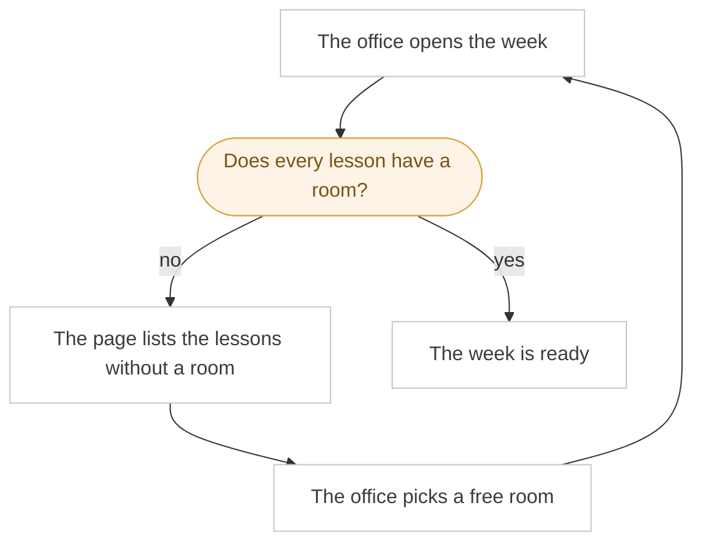

# See which lessons have no room

|  |  |
| -- | -- |
| **Who asks** | the school office — explains, does not sign |
| **Decides** | Nora |
| **Week** | Monday 16 → Friday 20 March |
| **Held by** | June |

## 1 · The principle

**The office sees which lessons have no room, and fixes them on the same page.**

|  |  |
| -- | -- |
| **For whom** | the office, each Friday, preparing the next week |
| **Today** | it checks timetable and paper room sheet by hand, and misses some |
| **Proof · a feedback** | two lessons in the corridor on 2 March — *seen* by June, once |
| **Proof · a number** | roomless lessons a week — *missing*: the office counts from 16 March |

## 2 · The diagram

## 3 · The rules

**R1** · A lesson **without a room** is flagged in the week.

**R2** · Only **free rooms** are offered.

**R3** · A room fits only if it has **the lesson's instrument**.

**R4** · **Only the office** assigns rooms.

## 4 · The watch-outs

| Point | What to know |
| -- | -- |
| ⚠️ **Q1 · Can a teacher change their lesson's room?** | For Nora. Sent 16 March. No written answer by Thursday 2 pm: **no**. |
| ⚠️ **Q2 · Is under an hour of Friday preparation the threshold?** | For Nora; the office proposed it. No written answer by Thursday 2 pm: **under an hour**. |
| **The right word** | "Room", not "studio" or "classroom". |
| **A rule that is coming** | Two rooms close for works in September. |
| **Not in this request** | Rooms outside lessons · the concert room sheet · moving a lesson |

## 5 · What exists

| State | What |
| -- | -- |
| ✅ built | The week view; rooms and their instruments, in the settings |
| ⏸ waiting | The full "rooms" request |
| ❓ to check | Can the week view read a room's instruments? — asked to Tomas |

## 6 · The success criterion

**First · before building, with the office, on three test weeks.**

| Test week | The office must read |
| -- | -- |
| every lesson has a room | ✅ "Week ready" |
| one lesson without a room | ❌ "1 lesson has no room" |
| a piano lesson, room without a piano | ❌ "Room 2: no piano" |

✅ **Passed if** the office reads each week right, in under a minute, without the paper sheet.

❌ **Failed if** it is wrong once, or goes back to the sheet.

**The verdict** · each one signs **themself**, in a comment: `Verdict signed · role · id · held`, or `not proven, to prove on <date>`, or `not held`.

**Second · thirty days after release.**

| What we look at | Counted by | The threshold |
| -- | -- | -- |
| Lessons starting without a room | the office | 0 in four weeks |
| Friday preparation time | the office | under an hour `[proposed]` |
| Must not get worse: teachers moved at the last minute `[proposed]` | the teachers | no worse than today |

Below the threshold: remove it · rework it · keep it — each one signs again, like the verdict.

## 7 · The bet

**We bet that** if the office sees every roomless lesson on one page, roomless lessons reach 0 in four weeks.

**Most likely wrong** — that the office opens this page instead of its paper sheet. The first test checks it.

Each one signs **themself**, in a comment, at the end of the session.

| Who | Comment to write |
| -- | -- |
| ⬜ Idris · Product | `Bet signed · Product · id` |
| ⬜ Mei · Design | `Bet signed · Design · id` |
| ⬜ Tomas · Engineering | `Bet signed · Engineering · id` |

⬜ not signed yet · ✅ signed. Same format for the freeze: `Freeze signed · role · id`.

The breakdown into screens is not here: the designer does it.

---

**Notes and sources** — *optional*

| Source | What it says |
| -- | -- |
| The school office, Monday 2 March | Two lessons had no room; nobody had seen it on Friday. |
| The settings page | Rooms and their instruments are already recorded. |
| Nora, message of 9 March | "No lesson in the corridor, ever." Source of the threshold of 0. |
| The school office, 12 March | Proposes "under an hour on Friday". Nora has not answered yet. |
| The draft | Proposed the line on teachers moved at the last minute. |
