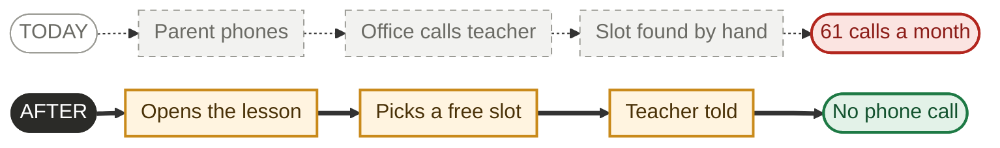

# [Brief] — Reschedule a lesson · executive summary

Session Monday 9 March, 10:00 · Decides: Nora · Brief: `brief-reschedule-a-lesson.md`

**The message.** Parents should be able to move a lesson that clashes to another slot of the same teacher, without phoning the office. The draft scope is ready. Before it can freeze, the session must settle whether the office may move lessons too.

- **Settled** — a lesson moves at least 24 hours before it starts (Nora). Everything else is proposed.
- **Why now** — parents phone the office, which calls the teacher back; 61 of 240 calls in February were about moving a lesson.
- **In** — a parent moves one lesson from its page, to a slot of the same teacher in the next 14 days; the teacher is told.
- **Out and later** — refunds → the billing brief · changing teacher → does not exist · group lessons → their own brief · later: teachers moving lessons, a waiting list.
- **To find out** — Tomas: free slots per teacher and day · Idris: pupils who moved a lesson last term — by Friday 6 March.

## To decide

- **T3 · Can the school office move a lesson for a parent?** — yes, from the week view · no, it only sees moves · Other. Mei holds yes, Idris no: it blocks the freeze.
- **T1 · How many lessons can a pupil move per term?** — no limit · two · three · Other. Idris proposes two.
- **T2 · Does the teacher have to accept the new slot?** — yes · no, the teacher is only told · Other. Mei holds yes.
- **G1 · Does this subject make the September term?** — yes · yes, reduced · no · Other. Missing it sends moves back to the phone until January.

## How we will know

Calls about moving a lesson: 61 a month today. Nora sets the threshold for thirty days after release. Lessons cancelled by teachers must not rise.

## Next step

The session on Monday 9 March settles T3 first, then T1, T2 and G1. Tomas, Idris and Mei confirm, then Nora freezes. Rules, scenarios, screen principles and sources are in the brief.
