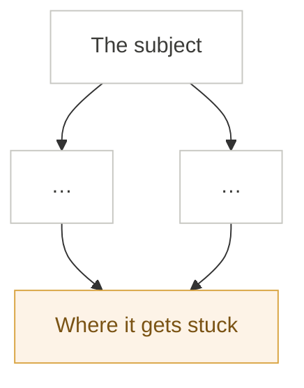

# [Brief] — <Verb> <Object>

* **Session** — *to schedule*
* **Version** — …
* **Spec or source** — …
* **Design file** — …
* **Present** — Decider · Product · Design · Engineering · Facilitator

> **This brief freezes the why and the scope.** Nothing is built or specified here.
>
> One answer ticked per question. If none fits, tick **Other** and write after it.
>
> **To decide:** T1 …? (under R2) · T2 …? (under R3) · T3 …? (under the scope) · G1 …? (deadline)

---

## Context

* **As** — who exactly, at what moment
* **I want** — the outcome, in their words; never a screen or a button
* **So that** — what changes for them
* **Today** — what they do instead, and why it is not enough
* **Proof** — a fact *seen* or *heard*, by whom, how many times · a number, or *missing*: who counts it, by when
* **We will know it worked** — what we count: today … · thirty days after release … · without <what must not get worse>

---

## 1 · Scope

**What this version contains** — N items, and nothing else.

* …
* …

**What will not be in it**, because it lives elsewhere or does not exist.

* … → where it lives, and who there knows it is coming
* … → does not exist

**What waits for a later version**, without leaving the target.

* …

⚠️ **T3 · The question that has no rule?** — *decides the scope line "…"*

- [ ] Option A — …
- [ ] Option B — …
- [ ] **Other** — …

---

## 2 · Business rules

Each rule carries its open question **right below it**: ⚠️ while it is open, ✔ once the session has settled it. A rule with no mark is settled.

**R1 · Title of the rule** — *product*

The rule, in one or two sentences.

**R2 · Title of the rule** — *legal · calculation · dependency · product*, and *one-way* if it cannot be undone

What is settled, in one or two sentences. The rest is settled by **T1**.

⚠️ **T1 · The question, in one sentence?** — *also decides R3, scenario 1*

- [ ] Option A — …
- [ ] Option B — …
- [ ] Option C — …
- [ ] **Other** — …

**R3 · Title of the rule** — *product*

What is settled, in one or two sentences. The rest is settled by **T2**.

⚠️ **T2 · The question, in one sentence?** — *also decides the scope line "…"*

- [ ] Option A — …
- [ ] Option B — …
- [ ] **Other** — …

---

## 3 · Acceptance scenarios

Three or four at most: the ones that say when it is right. The rest belongs to the spec.

**Scenario 1 — …**

* **Given** …
* **When** …
* **Then** …

**Scenario 2 — …**

* **Given** …
* **When** …
* **Then** …

---

## 4 · The principles of each screen — to tick

Keep this block only when screens exist. One block per screen, three or four principles: an intention the room can approve or refuse, never a list of components. Screens are named by the name of their frame in the design file.

**F1 — <frame name>**

- [ ] …
- [ ] …
- [ ] **Other** — …

**F2 — <frame name>**

- [ ] …
- [ ] …
- [ ] **Other** — …

---

## 5 · Open questions

What has no options: a fact to check, someone to go and ask. Five at most.

Each one is asked **in its own thread**, to a named person, with an answer requested before the session. The answer is given in the thread. Here, one line per question.

* **O1** · … — … — answer by …

---

## 6 · Deadline

**G1 · Does this subject make <the target date>?** — *missing it costs: …*

- [ ] **Yes** — all of it
- [ ] **Yes, reduced** — the lines that leave move to "waits" before the freeze
- [ ] **No** — after the date
- [ ] **Other** — …

---

## The freeze

- [ ] **Engineering** — "no major obstacle in here"
- [ ] **Product** — "I can write the spec"
- [ ] **Design** — "I can start the design"
- [ ] **Decider**, last — "the problem and the scope are the ones I want"

Each one ticks their own line, or writes it in a comment: `Freeze signed · role · id`. The facilitator runs the session and does not confirm. We freeze with holes, never with a disagreement on the why or the scope.

---

## Notes and sources — *optional*

| Source | What it says |
| -- | -- |
| … | … |

**Binding terms** — …

**Terms heard** — …
