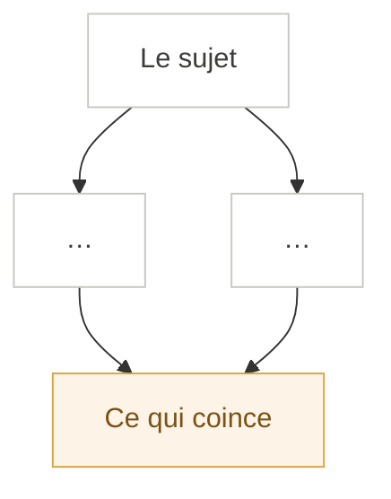

# [BC] — <Verbe> <Objet>

* **Séance** — *à programmer*
* **Version** — …
* **Spec ou source** — …
* **Fichier de design** — …
* **Présents** — Décideur · Produit · Design · Technique · Animateur

> **Ce brief gèle le pourquoi et le périmètre.** Rien ne se construit ni ne se spécifie ici.
>
> On coche une réponse par question. Si aucune ne convient, on coche **Autre** et on écrit à la suite.
>
> **À trancher :** T1 … ? (sous R2) · T2 … ? (sous R3) · T3 … ? (sous le périmètre) · G1 … ? (échéance)

---

## Contexte

* **En tant que** — qui exactement, à quel moment
* **Je veux** — le résultat, avec leurs mots ; jamais un écran ni un bouton
* **Afin de** — ce qui change pour eux
* **Aujourd'hui** — ce qu'ils font à la place, et pourquoi ça ne suffit pas
* **Preuve** — un fait *vu* ou *entendu*, par qui, combien de fois · un chiffre, ou *manquant* : qui le compte, pour quand
* **On saura que ça a marché** — ce qu'on compte : aujourd'hui … · trente jours après la mise en ligne … · sans <ce qui ne doit pas se dégrader>

---

## 1 · Périmètre

**Ce que cette version contient** — N éléments, et rien d'autre.

* …
* …

**Ce qui n'y entrera pas**, parce que ça vit ailleurs ou que ça n'existe pas.

* … → là où ça vit, et qui là-bas sait que ça arrive
* … → n'existe pas

**Ce qui attend une version ultérieure**, sans sortir de la cible.

* …

⚠️ **T3 · La question qui n'a pas de règle ?** — *commande la ligne de périmètre « … »*

- [ ] Option A — …
- [ ] Option B — …
- [ ] **Autre** — …

---

## 2 · Règles métiers

Chaque règle porte sa question ouverte **juste en dessous** : ⚠️ tant qu'elle est ouverte, ✔ quand la séance l'a tranchée. Une règle sans marque est acquise.

**R1 · Titre de la règle** — *produit*

L'énoncé de la règle, en une ou deux phrases.

**R2 · Titre de la règle** — *légale · calcul · dépendance · produit*, et *irréversible* si on ne peut pas la défaire

Ce qui est acquis, en une ou deux phrases. Le reste est tranché par **T1**.

⚠️ **T1 · La question, en une phrase ?** — *commande aussi R3, le scénario 1*

- [ ] Option A — …
- [ ] Option B — …
- [ ] Option C — …
- [ ] **Autre** — …

**R3 · Titre de la règle** — *produit*

Ce qui est acquis, en une ou deux phrases. Le reste est tranché par **T2**.

⚠️ **T2 · La question, en une phrase ?** — *commande aussi la ligne de périmètre « … »*

- [ ] Option A — …
- [ ] Option B — …
- [ ] **Autre** — …

---

## 3 · Scénarios d'acceptation

Trois ou quatre au maximum : ceux qui disent quand c'est bon. Le reste appartient à la spec.

**Scénario 1 — …**

* **Étant donné que** …
* **Quand** …
* **Alors** …

**Scénario 2 — …**

* **Étant donné que** …
* **Quand** …
* **Alors** …

---

## 4 · Les principes de chaque écran — à cocher

Bloc à garder seulement si des écrans existent. Un bloc par écran, trois ou quatre principes : une intention que la salle peut approuver ou refuser, jamais une liste de composants. Les écrans portent le nom de leur cadre dans le fichier de design.

**F1 — <nom du cadre>**

- [ ] …
- [ ] …
- [ ] **Autre** — …

**F2 — <nom du cadre>**

- [ ] …
- [ ] …
- [ ] **Autre** — …

---

## 5 · Questions ouvertes

Ce qui n'a pas d'options : un fait à vérifier, quelqu'un à aller chercher. Cinq au maximum.

Chacune est posée **dans son propre fil**, à une personne nommée, avec une réponse demandée avant la séance. La réponse se donne dans le fil. Ici, une ligne par question.

* **O1** · … — … — réponse pour le …

---

## 6 · Échéance

**G1 · Ce sujet tient-il <la date visée> ?** — *la manquer coûte : …*

- [ ] **Oui** — il entre au complet
- [ ] **Oui, réduit** — les lignes qui sortent passent dans « attend » avant le gel
- [ ] **Non** — après la date
- [ ] **Autre** — …

---

## Le gel

- [ ] **Technique** — « pas d'obstacle majeur là-dedans »
- [ ] **Produit** — « je peux écrire la spec »
- [ ] **Design** — « je peux commencer le design »
- [ ] **Décideur**, en dernier — « le problème et le périmètre sont ceux que je veux »

Chacun coche sa propre ligne, ou l'écrit en commentaire : `Gel signé · rôle · id`. L'animateur mène la séance et ne confirme pas. On gèle avec des trous, jamais avec un désaccord sur le pourquoi ou le périmètre.

---

## Notes et sources — *facultatif*

| Source | Ce qu'elle dit |
| -- | -- |
| … | … |

**Termes opposables** — …

**Termes entendus** — …
