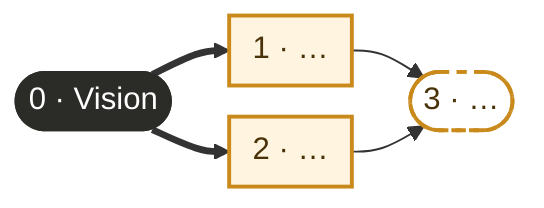

# Brief map — <Verb> <Object>

Idea: "…" · Decides: … · Drawn from …

**The estimate.** … outcomes (…), … groups (…), … decisions, … outside owners (…). …: … briefs, the vision first.

| Brief | What changes for the person | Form | Freezes |
| -- | -- | -- | -- |
| **0 · Vision** | … | full | 1st |
| **1 · …** | … | … | … |
| **2 · …** | … | … | … |
| **3 · …** | … | … | last |

## What each brief must settle

- **0 · Vision** — …? · …?
- **1 · …** — …?
- **2 · …** — …?
- **3 · …** — …?

**Off the map, to confirm** — … → later · … → not in it.

*Everything on this map is proposed. What comes from general knowledge is a question to check with its owner, not a rule.*
