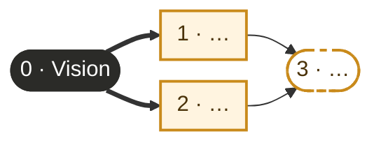

# Carte des briefs — <Verbe> <Objet>

Idée : « … » · Décide : … · Établie d'après …

**L'estimation.** … résultats (…), … groupes (…), … décisions, … propriétaires extérieurs (…). … : … briefs, la vision d'abord.

| Brief | Ce qui change pour la personne | Forme | Gèle |
| -- | -- | -- | -- |
| **0 · Vision** | … | complète | 1er |
| **1 · …** | … | … | … |
| **2 · …** | … | … | … |
| **3 · …** | … | … | en dernier |

## Ce que chaque brief doit trancher

- **0 · Vision** — … ? · … ?
- **1 · …** — … ?
- **2 · …** — … ?
- **3 · …** — … ?

**Hors de la carte, à confirmer** — … → plus tard · … → pas dedans.

*Tout ce qui est sur cette carte est proposé. Ce qui vient de connaissances générales est une question à vérifier auprès de son propriétaire, pas une règle.*
