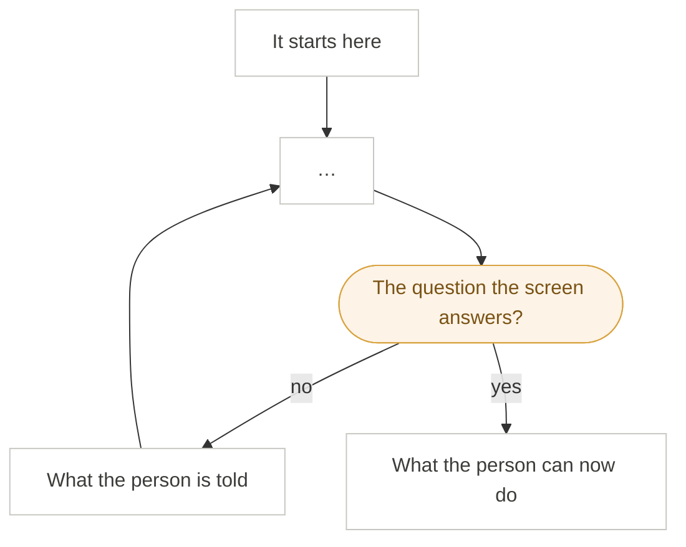

# <Verb> <Object>

|  |  |
| -- | -- |
| **Who asks** | … — explains, does not sign |
| **Decides** | … — answers the questions marked ⚠️, sets the threshold |
| **Week** | … → … |
| **Held by** | … |

## 1 · The principle

**One sentence: who sees or does what, once this exists.**

|  |  |
| -- | -- |
| **For whom** | … |
| **Today** | what they do instead, and what it costs |
| **Proof · a feedback** | … — *seen* or *heard*, by whom, how many times |
| **Proof · a number** | today's value, or *missing*: who counts it, from when |

## 2 · The diagram

## 3 · The rules

**R1** · …

**R2** · …

**R3** · …

## 4 · The watch-outs

| Point | What to know |
| -- | -- |
| ⚠️ **Q1 · …?** | For the decider. Sent on …. With no written answer before …: **…**. |
| ⚠️ **Q2 · …?** | The threshold, for the decider. With no written answer before …: **…**. |
| **The right word** | We say "…". Not "…". — or remove this row |
| **A rule that is coming** | … — or remove this row |
| **Not in this request** | … · … · … |

## 5 · What exists

| State | What |
| -- | -- |
| ✅ built | … |
| 🔄 in review | … |
| ⏸ waiting | … |
| ❓ to check | … — asked to … |

## 6 · The success criterion

**First · before building, with …, on three cases.**

| Case | The person must read |
| -- | -- |
| … | … |
| … | … |
| … | … |

✅ **Passed if** …

❌ **Failed if** …

**The verdict** · each one signs **themself**, in a comment: `Verdict signed · role · id · held`, or `not proven, to prove on <date>`, or `not held`.

**Second · thirty days after release.**

| What we look at | Counted by | The threshold |
| -- | -- | -- |
| … | … | … |
| Must not get worse: … | … | no worse than today |

Below the threshold: remove it · rework it · keep it — each one signs again, like the verdict.

## 7 · The bet

**We bet that** if …, then <what we count> reaches <the threshold>.

**Most likely wrong** — the part of the bet the first test checks: …

Each one signs **themself**, in a comment, at the end of the session.

| Who | Comment to write |
| -- | -- |
| ⬜ Product | `Bet signed · Product · id` |
| ⬜ Design | `Bet signed · Design · id` |
| ⬜ Engineering | `Bet signed · Engineering · id` |

⬜ not signed yet · ✅ signed. Same format for the freeze: `Freeze signed · role · id`.

The breakdown into screens is not here: the designer does it.

---

**Notes and sources** — *optional*

| Source | What it says |
| -- | -- |
| … | … |
