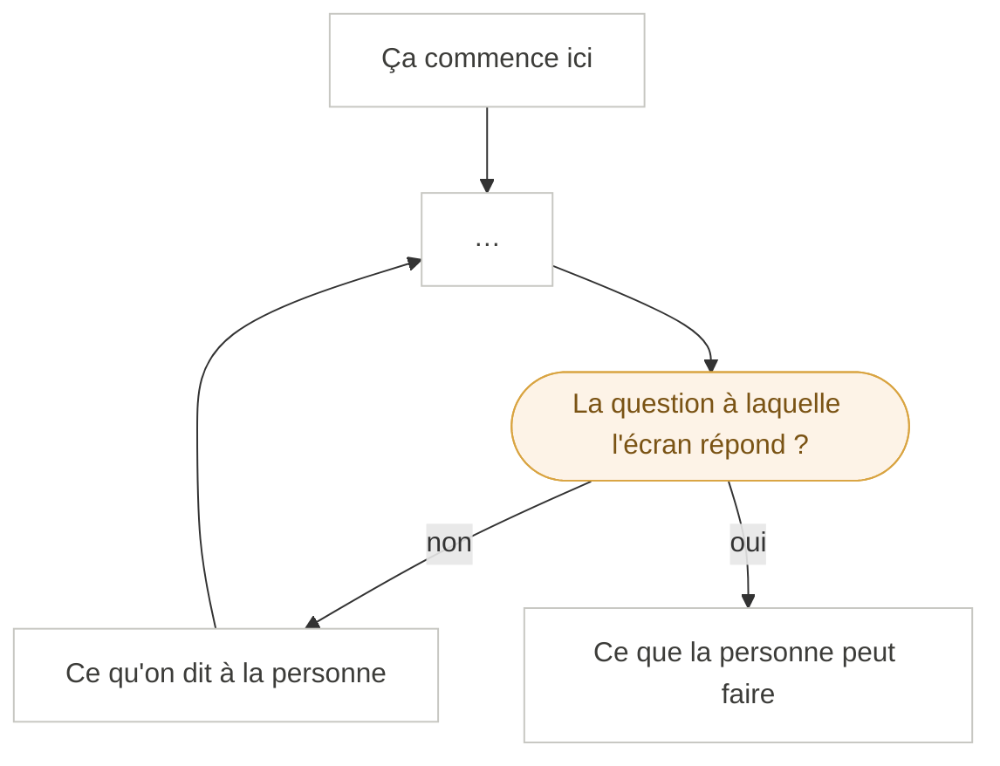

# <Verbe> <Objet>

|  |  |
| -- | -- |
| **Qui demande** | … — explique, ne signe pas |
| **Décide** | … — répond aux questions ⚠️, fixe le seuil |
| **Semaine** | … → … |
| **Tenu par** | … |

## 1 · Le principe

**Une phrase : qui voit ou fait quoi, une fois que ça existe.**

|  |  |
| -- | -- |
| **Pour qui** | … |
| **Aujourd'hui** | ce qu'ils font à la place, et ce que ça coûte |
| **La preuve · un retour** | … — *vu* ou *entendu*, par qui, combien de fois |
| **La preuve · un chiffre** | la valeur aujourd'hui, ou *manquant* : qui le compte, à partir de quand |

## 2 · Le schéma

## 3 · Les règles

**R1** · …

**R2** · …

**R3** · …

## 4 · Les points de vigilance

| Point | Ce qu'il faut savoir |
| -- | -- |
| ⚠️ **Q1 · … ?** | Pour le décideur. Envoyée le …. Sans réponse écrite avant … : **…**. |
| ⚠️ **Q2 · … ?** | Le seuil, pour le décideur. Sans réponse écrite avant … : **…**. |
| **Le bon mot** | On dit « … ». Pas « … ». — ou retirer cette ligne |
| **Une règle qui arrive** | … — ou retirer cette ligne |
| **Pas dans cette demande** | … · … · … |

## 5 · L'existant

| État | Quoi |
| -- | -- |
| ✅ construit | … |
| 🔄 en revue | … |
| ⏸ en attente | … |
| ❓ à vérifier | … — demandé à … |

## 6 · Le critère de réussite

**1er temps · avant de construire, avec …, sur trois cas.**

| Cas | La personne doit lire |
| -- | -- |
| … | … |
| … | … |
| … | … |

✅ **Réussi si** …

❌ **Échec si** …

**Le verdict** · chacun signe **lui-même**, en commentaire : `Verdict signé · rôle · id · tenu`, ou `non prouvé, à prouver le <date>`, ou `non tenu`.

**2e temps · trente jours après la mise en ligne.**

| Ce qu'on regarde | Compté par | Le seuil |
| -- | -- | -- |
| … | … | … |
| Ne doit pas se dégrader : … | … | pas pire qu'aujourd'hui |

Sous le seuil : retirer · retravailler · garder — chacun signe à nouveau, comme pour le verdict.

## 7 · Le pari

**On parie que** si …, alors <ce qu'on compte> atteint <le seuil>.

**Le plus fragile** — la partie du pari que le premier test vérifie : …

Chacun signe **lui-même**, en commentaire, à la fin de la séance.

| Qui | Commentaire à écrire |
| -- | -- |
| ⬜ Produit | `Pari signé · Produit · id` |
| ⬜ Design | `Pari signé · Design · id` |
| ⬜ Technique | `Pari signé · Technique · id` |

⬜ pas encore signé · ✅ signé. Même format pour le gel : `Gel signé · rôle · id`.

Le découpage en écrans n'est pas ici : c'est le designer qui le fait.

---

**Notes et sources** — *facultatif*

| Source | Ce qu'elle dit |
| -- | -- |
| … | … |
