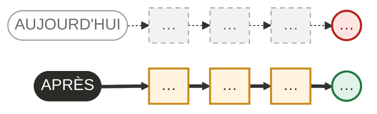

# [BC] — <Verbe> <Objet> · résumé exécutif

Séance … · Décide : … · Brief : …

**Le message.** …

- **Acquis** — …
- **Pourquoi maintenant** — …
- **Dedans** — …
- **Dehors et plus tard** — … → … · plus tard : …
- **À instruire** — … — avant le …

## À trancher

- **T1 · … ?** — … · … · Autre. …

## Comment on saura

…

## Prochaine étape

… Règles, scénarios, principes d'écran et sources sont dans le brief.
